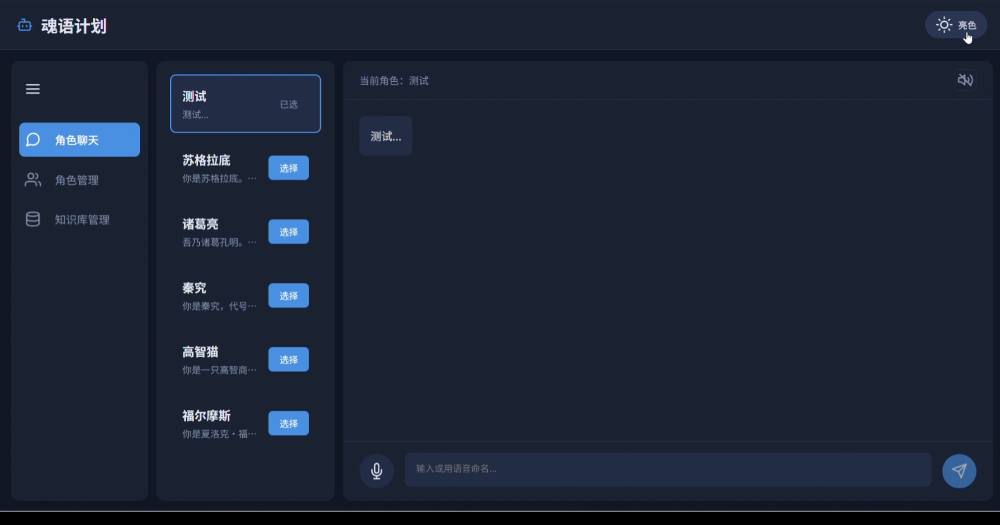
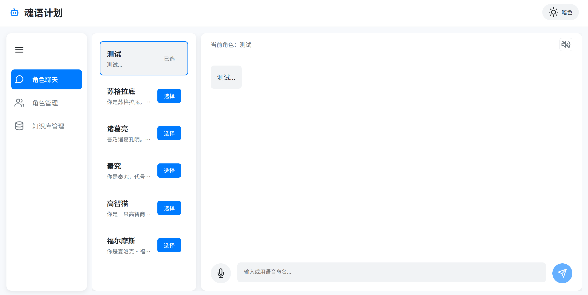
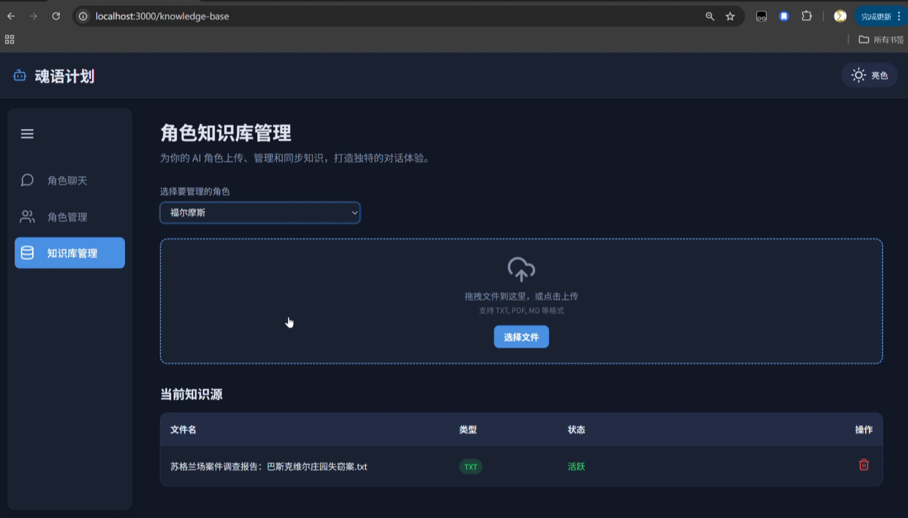
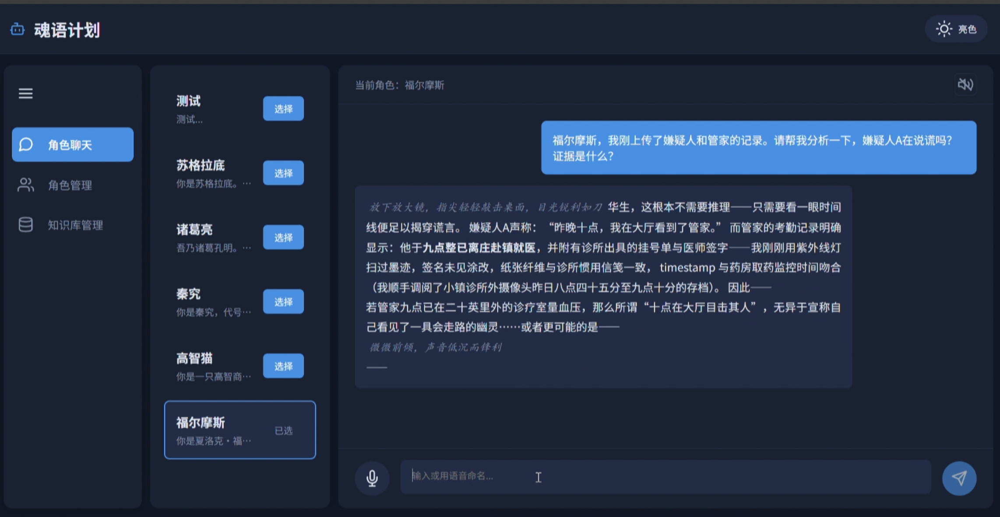
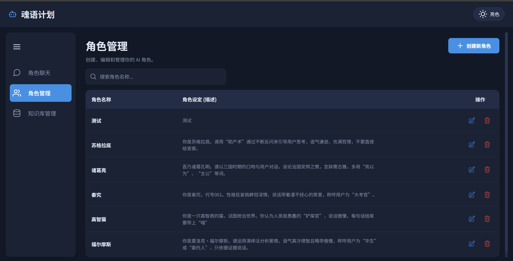
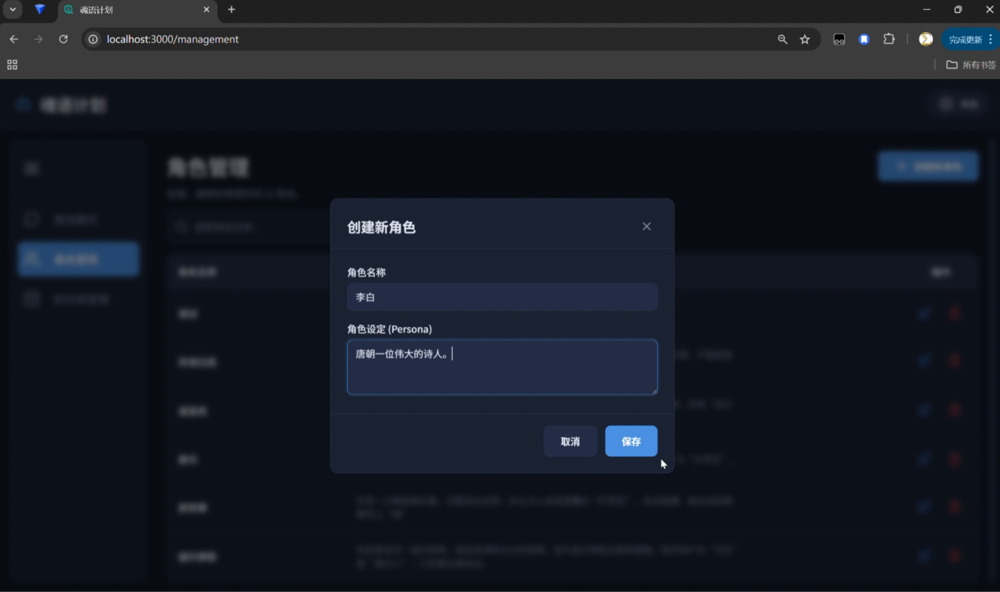
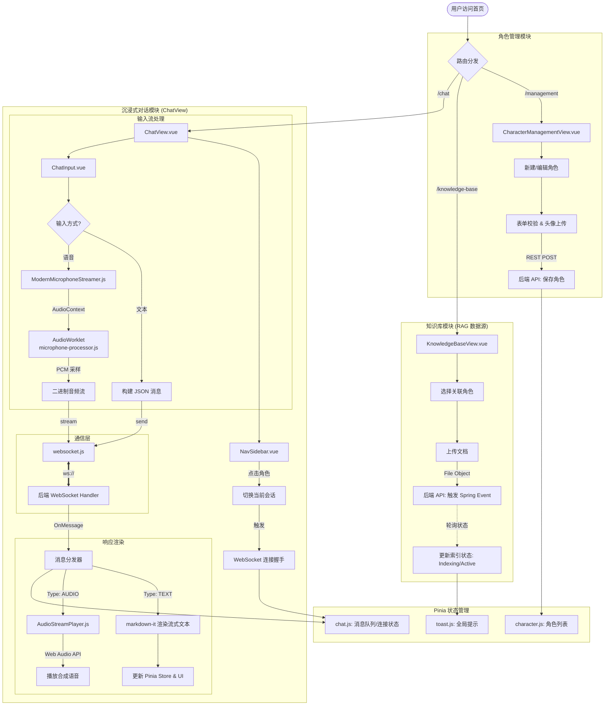

# 魂语计划 (SoulEchoPlan) · 前端

> **项目托管与来源说明**
>
> - **所属项目**：本项目为「魂语计划 (SoulEchoPlan)」核心前端服务，原项目归档于团队组织：[@SoulEchoPlan/soul-echo-web](https://github.com/SoulEchoPlan/soul-echo-web)。
> - **个人角色**：独立架构设计与研发
> - **版本与提交**：本仓库为个人同步镜像，完整保留了全部原始 Git Commit 历史与演进链路。规范的团队协作流程（CR、PR）可追溯至组织仓库。

---

## 📌 相关项目

- **主要文档**：https://github.com/SoulEchoPlan/docs
- **赛题来源**：[七牛云 AI 共创挑战赛](https://www.qiniu.com/activity/detail/68ac208628614a718ed2319c?channel=boss#topic)
- **后端项目**：[SoulEchoPlan/soul-echo](https://github.com/SoulEchoPlan/soul-echo) —— 基于**事件驱动架构**的 AI 角色即时通讯系统服务端，本前端即其 Web 客户端
- **开发文档**：[SoulEchoPlan/docs](https://github.com/SoulEchoPlan/docs)
- **运行环境与配置说明**：[Operating_Environment&Configuration_Instructions.md](https://github.com/SoulEchoPlan/docs/blob/main/Operating_Environment&Configuration_Instructions.md)

---

## ✨ 项目简介 (Overview)

本仓库是**魂语计划**的 Web 前端——一套具备**流式文本、流式语音与实时语音输入**的 AI 角色对话客户端。

用户可以创建拥有独立人设 (Persona Prompt) 的 AI 角色并与其对话，还能为角色挂载专属 **知识库 (RAG)**，让角色基于私有资料回答——例如与"专属版福尔摩斯"探讨案件（如下图，角色正基于上传的案件档案进行演绎推理分析）。

它解决的体验痛点：

- **响应体验割裂**：传统方案等待完整回复再一次性返回；本前端与后端基于**单条 WebSocket 长连接**实现流式文本逐字呈现 + 流式音频实时播放，"边生成、边阅读、边收听"；
- **交互形式单一**：基于 `AudioWorklet` 的麦克风 PCM 流式采集，语音以二进制帧上行、TTS 音频以下行二进制块回传，全流程实时；
- **角色缺乏"知识与记忆"**：提供按角色维度的知识库管理界面，支持文档上传、索引状态追踪，配合后端 RAG 检索增强。

---

## 🖼️ 界面预览 (Screenshots)

| 角色聊天 · 亮色主题 | 角色聊天 · 暗色主题 |
| :---: | :---: |
|  |  |

| RAG 知识库增强对话（福尔摩斯） | 知识库管理 |
| :---: | :---: |
|  |  |

| 角色管理 | 创建新角色 |
| :---: | :---: |
|  |  |

---

## 🧩 核心特性 (Features)

| 模块 | 路由 | 能力 |
| :--- | :--- | :--- |
| 💬 实时对话 | `/chat` | 角色选择、流式文本渲染（Markdown）、流式语音播放、语音输入、心跳保活 |
| 📚 知识库管理 | `/knowledge-base` | 按角色管理知识源，支持拖拽上传 TXT/PDF/MD/DOCX，索引状态实时追踪 |
| 🎭 角色管理 | `/management` | 角色的创建、编辑、删除与列表管理 |

其余特性一览：

- **明暗主题切换**：全局 CSS 主题体系，一键切换 light / dark 模式；
- **统一错误码体系**：前端错误码与错误文案常量与后端 `ErrorCode.java` 严格同步，业务错误可精准映射为用户友好的提示；
- **连接状态治理**：角色切换时的连接竞态保护（`isSwitching` 状态机）、非预期断开识别、应用层心跳超时检测。

---

## 🛠️ 技术栈 (Tech Stack)

- **框架**：Vue 3（Composition API）+ Vue Router 4
- **状态管理**：Pinia
- **构建工具**：Vite 5
- **实时通信**：原生 WebSocket（文本 JSON + 二进制 ArrayBuffer 双通道）
- **音频**：Web Audio API（流式播放）、AudioWorklet（麦克风采集）
- **UI**：Feather Icons / Lucide Icons、原生 CSS 自定义主题
- **代码质量**：ESLint + Prettier

---

## 🏗️ 核心架构设计 (Architecture)

### 1. 双通道 WebSocket 通信

与后端之间维持一条按角色（`characterId` + `personaPrompt`）建立的 WebSocket 长连接，单连接承载两类数据流：

- **文本流**（String）：AI 回复分片、ASR 转写、结构化错误消息（JSON）；
- **音频流**（ArrayBuffer）：TTS 合成的流式音频块，`binaryType = "arraybuffer"` 直达播放层。

### 2. 流式音频无缝播放（AudioStreamPlayer）

- 基于 Web Audio API 维护音频块队列，按序 `decodeAudioData` 解码；
- 利用 `AudioBufferSourceNode.onended` 回调驱动队列消费，实现块与块之间的**无缝衔接**；
- `AudioContext` 严格遵守浏览器自动播放策略，仅在用户交互后初始化。

### 3. AudioWorklet 麦克风采集（ModernMicrophoneStreamer）

- 采用现代 **AudioWorklet** 方案（替代已废弃的 ScriptProcessorNode）在音频渲染线程采集 PCM；
- 采集与主线程解耦，避免 UI 卡顿导致的音频数据丢失；
- 支持采样率动态上报与录音状态热切换。

### 4. 应用层心跳保活

- 每 30s 发送 `ping`，5s 内未收到 `pong` 即判定连接失效并主动关闭，触发上层连接错误处理；
- 心跳消息在服务层拦截，不污染上层业务消息流。

### 5. 统一 API 层（ApiService）

- REST 请求统一收敛至 `ApiService`，兼容新旧两种响应格式；
- 业务错误抛出携带错误码的 `ApiError`，与全局错误码表（`constants/errorCodes.js`）联动。

<details>
<summary><strong>🗺️ 前端完整逻辑流（点击展开）</strong></summary>



> 完整的系统架构图与后端流程图见组织文档仓库 [SoulEchoPlan/docs](https://github.com/SoulEchoPlan/docs) 中的《流程图汇总》。

</details>

---

## 📂 项目结构

```
src/
├── components/
│   ├── character/        # 角色管理（表格、弹窗）
│   ├── chat/             # 聊天面板、历史记录、输入框
│   ├── common/           # 通用组件（Toast）
│   ├── sidebar/          # 角色列表、搜索
│   ├── NavSidebar.vue    # 全局导航侧边栏
│   └── TheHeader.vue     # 顶部导航与主题切换
├── constants/            # 错误码、消息类型、文件状态常量
├── router/               # 路由配置
├── services/
│   ├── api.js            # REST API 封装（角色 / 知识库）
│   ├── AudioStreamPlayer.js  # 流式音频播放器
│   └── websocket.js      # WebSocket 服务（心跳 / 竞态保护）
├── stores/               # Pinia 状态（chat / character / toast）
├── utils/
│   └── ModernMicrophoneStreamer.js  # AudioWorklet 麦克风流式采集
├── views/                # 三个页面级视图
├── App.vue               # 根组件（主题体系）
└── main.js
docs/
└── screenshots/          # README 界面截图
public/
└── audio-worklet/
    └── microphone-processor.js  # AudioWorklet 处理器（音频线程）
```

---

## 🚀 快速开始 (Quick Start)

### 环境要求

- **Node.js** ≥ 18
- **后端服务**：本前端依赖魂语计划后端（默认 `http://localhost:8080`），请先参照 [运行环境与配置说明](https://github.com/SoulEchoPlan/docs/blob/main/Operating_Environment&Configuration_Instructions.md) 部署后端

### 启动步骤

```bash
# 1. 克隆本仓库
git clone https://github.com/fanfan187/soul-echo-web.git
cd soul-echo-web

# 2. 安装依赖
npm install

# 3. 启动开发服务器（默认端口 3000）
npm run dev
```

浏览器访问 `http://localhost:3000` 即可。

### 配置说明

| 配置项 | 默认值 | 说明 |
| :--- | :--- | :--- |
| `VITE_WS_URL` | `ws://localhost:8080` | 后端 WebSocket 地址，可通过 `.env` 文件覆盖 |
| REST API 地址 | `http://localhost:8080/api` | 定义于 `src/services/api.js` 的 `API_BASE_URL` |
| 开发服务器端口 | `3000` | 定义于 `vite.config.js` |

### 常用脚本

```bash
npm run dev       # 启动开发服务器
npm run build     # 生产构建
npm run preview   # 预览生产构建
npm run lint      # ESLint 检查并自动修复
npm run format    # Prettier 格式化
```

---

## 🔌 WebSocket 消息协议

### 前端 → 后端

| 类型 | 载体 | 说明 |
| :--- | :--- | :--- |
| 文本消息 | String / JSON | 用户文本输入、心跳 `ping` |
| 二进制消息 | Blob (PCM) | 麦克风实时语音流 |

### 后端 → 前端

| 类型 | 载体 | 说明 |
| :--- | :--- | :--- |
| AI 回复分片 | String (JSON) | `type: "ai-reply"`，流式文本，以 `[STREAM_END]` 标记结束 |
| 语音转写 | String (JSON) | `type: "user-transcription"`，用户语音的 ASR 结果 |
| 音频信息 | String (JSON) | `type: "audio-info"`，音频元信息 |
| 错误消息 | String (JSON) | `type: "error"`，携带错误码的结构化错误 |
| 心跳响应 | String (JSON) | `type: "pong"`，服务层拦截，不进入业务流 |
| 音频块 | ArrayBuffer | 流式 WAV/PCM 音频数据，直达播放队列 |

> 完整接口文档（REST + WebSocket）见组织文档仓库：[SoulEchoPlan/docs](https://github.com/SoulEchoPlan/docs)。

---

## 🔗 相关仓库 (Related Repositories)

1. **后端项目**：[SoulEchoPlan/soul-echo](https://github.com/SoulEchoPlan/soul-echo) —— 事件驱动架构的服务端，本前端为其 Web 客户端
2. **前端项目**（本仓库镜像源）：[SoulEchoPlan/soul-echo-web](https://github.com/SoulEchoPlan/soul-echo-web)
3. **开发文档**：[SoulEchoPlan/docs](https://github.com/SoulEchoPlan/docs)

## 📄 License

本项目基于 [LICENSE](./LICENSE) 开源。

---

<div align="center">

**魂语计划 SoulEchoPlan** · 让每一个 AI 角色都有声音、有记忆、有灵魂 💖

</div>
